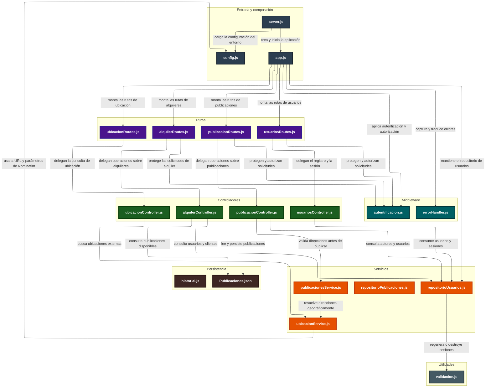

# `Diagrama de Capas`

Este diagrama representa los módulos actuales y sus relaciones de composición o dependencia. No incluye atributos, firmas ni reglas internas.

Las entidades de dominio y la jerarquía de errores se documentan por separado en [`Diagrama de Clases.md`](./Diagrama%20de%20Clases.md).

Para visualizar el preview del archivo en VSCode se puede usar una extensión Mermaid como: https://marketplace.visualstudio.com/items?itemName=MermaidChart.vscode-mermaid-chart.

## Estado actual

- `repositorioPublicaciones.js` existe, pero no está conectado al flujo de controladores.
- `historial.js` está vacío y no participa en las rutas actuales.
- Los alquileres mantienen su historial en memoria dentro de los clientes.
- Las publicaciones se leen y escriben directamente desde `Publicaciones.json`.
- `app.js` configura directamente los parsers de Express y las sesiones.
- La hidratación consulta `req.session.userId` y asigna el usuario a `req.user` mediante middleware inline en `app.js`; no existe un módulo separado.
