# `Diagrama de Clases - Layers`

Para visualizar el preview del archivo en VSCode es requerida una extension Mermaid como: https://marketplace.visualstudio.com/items?itemName=MermaidChart.vscode-mermaid-chart. (No es necesario crear cuenta o iniciar sesion).

Recomendamos seleccionar el tema de visualizacion "Redux-Color" o "Redux-Dark-Color" para la extension Mermaid, ya que es la que mayor visibilidad ofrece.

El diagrama representa las capas y elementos implementados actualmente; omite las operaciones de publicaciones que todavía no tienen ruta.

```mermaid
---
config:
  layout: elk
---

classDiagram

%% ===================================================================
%% STYLING (Bigger, bolder, and color-coded by layer)
%% ===================================================================
classDef entry fill:#2C3E50,stroke:#1A252F,stroke-width:3px,color:#ffffff,font-weight:bold,font-size:16px;
classDef middleware fill:#006064,stroke:#00363A,stroke-width:3px,color:#ffffff,font-weight:bold,font-size:16px;
classDef routes fill:#4A148C,stroke:#311B92,stroke-width:3px,color:#ffffff,font-weight:bold,font-size:16px;
classDef controllers fill:#1B5E20,stroke:#0A3D0A,stroke-width:3px,color:#ffffff,font-weight:bold,font-size:16px;
classDef services fill:#E65100,stroke:#BF360C,stroke-width:3px,color:#ffffff,font-weight:bold,font-size:16px;
classDef repositories fill:#3E2723,stroke:#271310,stroke-width:3px,color:#ffffff,font-weight:bold,font-size:16px;
classDef models fill:#0D47A1,stroke:#082D68,stroke-width:3px,color:#ffffff,font-weight:bold,font-size:16px;
classDef errors fill:#B71C1C,stroke:#7F0000,stroke-width:3px,color:#ffffff,font-weight:bold,font-size:16px;
classDef utils fill:#455A64,stroke:#263238,stroke-width:3px,color:#ffffff,font-weight:bold,font-size:16px;

%% ===================================================================
%% LAYER 1: ENTRY / COMPOSICION
%% ===================================================================
namespace Entry {
    class server_js["server.js"]:::entry {
        +loadConfig()
        +createApp(config)
        +listen(config.port)
    }
    class app_js["app.js"]:::entry {
        +Express app
        -usuarios: RepositorioUsuarios
        +use(express.urlencoded)
        +use(express.json)
        +use(session)
        +use(hidratarUsuario)
        +use("/usuarios", crearUsuariosRoutes)
        +use("/api/ubicacion", ubicacionRoutes)
        +use("/api/publicaciones", crearPublicacionRoutes)
        +use("/api/alquileres", crearAlquilerRoutes)
        +get("/me", requireAuth)
        +get("/api/salud")
        +use(express.static)
        +use(errorHandler)
    }
}

%% ===================================================================
%% LAYER 2: MIDDLEWARE (Transversal)
%% ===================================================================
namespace Middleware {
    class hidratacion["Hidratación inline req.user"]:::middleware {
        +hidratarUsuario(req, res, next)
        +busca usuario por req.session.userId
    }
    class requireAuth["requireAuth"]:::middleware {
        +requireAuth(req, res, next)
        -lanza UnauthorizedError si !req.user
    }
    class rol["rol(tipo)"]:::middleware {
        +rol(tipo)(req, res, next)
        -lanza UnauthorizedError o ForbiddenError
    }
    class errorHandler["errorHandler"]:::middleware {
        +errorHandler(err, req, res, next)
        -traduce AppError a status y message
    }
    class bodyParsers["express.urlencoded / express.json"]:::middleware
    class sessionMiddleware["express-session"]:::middleware
}

%% ===================================================================
%% LAYER 3: ROUTES (Mapeo URL + Metodo)
%% ===================================================================
namespace Routes {
    class crearUsuariosRoutes["crearUsuariosRoutes (factory)"]:::routes {
        +Router
        -router.get("/", requireAuth, listarUsuarios)
        -router.get("/me", buscarLogueado)
        -router.post("/", agregar)
        -router.get("/correo/:correo", requireAuth, buscarPorCorreo)
        -router.post("/login", iniciarSesion)
        -router.post("/logout", requireAuth, cerrarSesion)
    }
    class crearPublicacionRoutes["crearPublicacionRoutes (factory)"]:::routes {
        +Router
        -router.get("/", listarPublicaciones)
        -router.post("/", crearPublicacion)
        -router.post("/validar-direccion", validarDireccion)
        -router.get("/:id/reportes", requireAuth, rol(Propietario))
        -router.post("/:id/reportes", requireAuth, rol(Cliente))
        -router.post("/:id/valoraciones", requireAuth, rol(Cliente))
        -router.get("/:id/valoraciones", requireAuth, rol(Propietario))
    }
    class crearAlquilerRoutes["crearAlquilerRoutes (factory)"]:::routes {
        +Router
        -router.get("/", requireAuth, listarAlquileres)
        -router.post("/", requireAuth, crearAlquiler)
        -router.patch("/:id/cancelar", requireAuth, cancelarAlquiler)
        -router.get("/propietario", requireAuth, listarAlquileresPropietario)
        -router.patch("/:id/estado", requireAuth, actualizarEstadoAlquiler)
    }
    class ubicacionRoutes["ubicacionRoutes.js"]:::routes {
        +Router
        -router.get("/", obtenerUbicacion)
    }
}

%% ===================================================================
%% LAYER 4: CONTROLLERS (Traducen HTTP)
%% ===================================================================
namespace Controllers {
    class UserController:::controllers {
        -userService: RepositorioUsuarios
        +listarUsuarios(req, res, next)
        +agregar(req, res, next)
        +buscarPorCorreo(req, res, next)
        +iniciarSesion(req, res, next)
        +cerrarSesion(req, res, next)
        +buscarLogueado(req, res, next)
    }
    class publicacionController["publicacionController.js"]:::controllers {
        +listarPublicaciones(req, res, next, usuarios)
        +crearPublicacion(req, res, next, usuarios)
        +validarDireccion(req, res, next)
        +reportarPublicacion(req, res, next, usuarios)
        +listarReportesPublicacion(req, res, next)
        +valorarPublicacion(req, res, next)
        +listarValoracionesPublicacion(req, res, next, usuarios)
    }
    class alquilerController["alquilerController.js"]:::controllers {
        <<mezcla lógica + acceso a datos>>
        +listarAlquileres(req, res)
        +crearAlquiler(req, res, next)
        +cancelarAlquiler(req, res)
        +listarAlquileresPropietario(req, res, usuarios)
        +actualizarEstadoAlquiler(req, res, usuarios)
    }
    class ubicacionController["ubicacionController.js"]:::controllers {
        +obtenerUbicacion(req, res)
    }
}

%% ===================================================================
%% LAYER 5: SERVICES (Reglas de negocio)
%% ===================================================================
namespace Services {
    class RepositorioUsuarios:::services {
        <<mezcla servicio + repositorio>>
        -usuarios: Usuario[]
        +agregarUsuario(usuario): Usuario
        +agregarCliente(...)
        +agregarPropietario(...)
        +buscarUsuarioPorCorreo(correo)
        +iniciarSesion(correo, contrasena, req)
        +cerrarSesion(req)
        +verify(correo, contrasena)
        +toPublic(usuario)
    }
    class publicacionesService["publicacionesService.js"]:::services {
        +validarDireccionPublicacion(direccion)
    }
    class ubicacionService["ubicacionService.js"]:::services {
        <<adapter Nominatim>>
        +buscarUbicacionPorTexto(texto): Direccion
    }
}

%% ===================================================================
%% LAYER 6: REPOSITORIES (Persistencia)
%% ===================================================================
namespace Repositories {
    class RepositorioPublicaciones:::repositories {
        -publicaciones: Publicacion[]
        -proximoId: number
        +crearPublicacion(...)
        +buscarPublicacionPorId(id)
        +buscarActivas()
        +cargarDesde(publicaciones)
    }
    class PublicacionesJson["Publicaciones.json (datos persistidos)"]:::repositories {
        +Publicacion[] publicaciones
        +Reporte[] reportesPorPublicacion
        +Valoracion[] valoracionesPorPublicacion
    }
}

%% ===================================================================
%% LAYER 7: MODELS (Entidades de dominio implementadas)
%% ===================================================================
namespace Models {
    class Usuario:::models {
        +String nombre
        +String apellido
        +String correo
        +String contrasena
        +String telefono
        +boolean activo
        +Reporte[] reportes
    }
    class Cliente:::models {
        +String tipo = "Cliente"
        +Alquiler[] historial
    }
    class Propietario:::models {
        +String tipo = "Propietario"
        +Publicacion[] publicaciones
    }
    class Publicacion:::models {
        +int id
        +String titulo
        +String descripcion
        +String direccion
        +String ubicacion
        +Number precio
        +String autor
        +String imagen
        +String alt
        +String tipo
        +Number calificacion
        +Number cantidadValoraciones
        +String detalle
        +String disponibilidad
        +String estado
        +boolean activa
        +Date fechaCreacion
        +Reporte[] reportes
        +Valoracion[] valoraciones
        +reportar(motivo, descripcion, correo)
        +valorar(puntuacion, comentario, emisor)
        +calcularCalificacion()
    }
    class Alquiler:::models {
        +String id (UUID)
        +Object producto
        +String fechaInicio
        +String fechaFin
        +String estado
        +Date fechaSolicitud
        +cancelar()
        +finalizar()
    }
    class Direccion:::models {
        +String direccionCompleta
        +Number lat
        +Number lon
        +Object direccion
    }
    class Reporte:::models {
        +int id
        +String motivo
        +String descripcion
        +String reportante
        +Date fecha
        +String estado
        +consultarEstado()
    }
    class Producto:::models {
        +int id
        +String nombre
        +Object imagen
        +Number promedioValoraciones
    }
    class Propiedad:::models {
        +Object direccion
        +String tipo = "Propiedad"
    }
    class Valoracion:::models {
        +Number puntuacion
        +String comentario
        +String emisor
    }
}

%% ===================================================================
%% LAYER 8: ERRORS (Jerarquia de errores)
%% ===================================================================
namespace Errors {
    class AppError:::errors {
        +String message
        +int status
    }
    class ConflictError:::errors {
        +int status = 409
    }
    class NotFoundError:::errors {
        +int status = 404
    }
    class ValidationError:::errors {
        +int status = 400
    }
    class UnauthorizedError:::errors {
        +int status = 401
    }
    class ForbiddenError:::errors {
        +int status = 403
    }
}

%% ===================================================================
%% LAYER 9: UTILS (Helpers puros)
%% ===================================================================
namespace Utils {
    class validacion_js["utils/validacion.js"]:::utils {
        +regenerate(req): Promise
        +destroy(req): Promise
    }
}

%% ===================================================================
%% CODE FLOW & RELATIONS (De afuera hacia adentro)
%% ===================================================================

%% --- Entry / composicion ---
server_js "1" --> "1" app_js : carga config, crea app y abre el puerto
app_js "1" --> "1" bodyParsers : registra express.urlencoded y express.json
app_js "1" --> "1" sessionMiddleware : registra express-session
app_js "1" --> "1" hidratacion : asigna req.user antes de los routers
app_js "1" --> "1" crearUsuariosRoutes : invoca factory, inyecta repo, monta /usuarios
app_js "1" --> "1" crearPublicacionRoutes : invoca factory, inyecta usuarios, monta /api/publicaciones
app_js "1" --> "1" crearAlquilerRoutes : invoca factory, inyecta usuarios, monta /api/alquileres
app_js "1" --> "1" ubicacionRoutes : importa router, monta /api/ubicacion
app_js "1" --> "1" requireAuth : protege GET /me
app_js "1" --> "1" errorHandler : registra al final para errores delegados
app_js "1" --> "1" RepositorioUsuarios : crea (new) al arrancar, consulta en hidratacion

%% --- Routes -> Middleware / Controllers ---
crearUsuariosRoutes "1" --> "1" requireAuth : protege listado, búsqueda por correo y cierre de sesión
crearUsuariosRoutes "1" --> "1" UserController : crea (new) por factory, inyecta repo
crearPublicacionRoutes "1" --> "1" publicacionController : importa y asigna a rutas
crearPublicacionRoutes "1" --> "1" requireAuth : protege reportes y valoraciones
crearPublicacionRoutes "1" --> "1" rol : requiere Cliente o Propietario según la ruta
crearAlquilerRoutes "1" --> "1" requireAuth : aplica en todas las rutas
crearAlquilerRoutes "1" --> "1" alquilerController : importa y asigna a rutas
ubicacionRoutes "1" --> "1" ubicacionController : importa y asigna a ruta

%% --- Controllers -> Services / Repositories ---
UserController "1" --> "1" RepositorioUsuarios : recibe inyectada, delega reglas
publicacionController "1" --> "1" publicacionesService : valida direccion al publicar
publicacionController "1" --> "1" PublicacionesJson : lee y escribe publicaciones, reportes y valoraciones
publicacionController "1" --> "1" RepositorioUsuarios : busca autores y nombres para respuestas
publicacionController "1" ..> "0..*" Publicacion : crea publicaciones y aplica reportar/valorar
alquilerController "1" --> "1" PublicacionesJson : lee publicaciones para crear alquileres
alquilerController "1" --> "1" Cliente : usa req.user e historial en memoria
alquilerController "1" ..> "0..*" Alquiler : crea y actualiza alquileres
ubicacionController "1" --> "1" ubicacionService : busca ubicación

%% --- Middleware -> Errors ---
requireAuth "1" ..> "0..*" UnauthorizedError : crea (new) y lanza si falta user
rol "1" ..> "0..*" UnauthorizedError : crea (new) si falta user
rol "1" ..> "0..*" ForbiddenError : crea (new) si el rol no coincide
errorHandler "1" ..> "0..*" AppError : recibe via next(), traduce status, enmascara 500

%% --- Repositorios -> Modelos / Errores / Utils ---
RepositorioUsuarios "1" ..> "0..*" Cliente : crea (new) tipo Cliente
RepositorioUsuarios "1" ..> "0..*" Propietario : crea (new) tipo Propietario
RepositorioUsuarios "1" ..> "0..*" ValidationError : crea (new) y lanza si duplicado/invalido
RepositorioUsuarios "1" ..> "0..*" NotFoundError : crea (new) y lanza si no existe
RepositorioUsuarios "1" --> "1" validacion_js : usa regenerate/destroy en auth

RepositorioPublicaciones "1" ..> "0..*" Publicacion : administra un arreglo en memoria
PublicacionesJson "1" --> "0..*" Publicacion : datos guardados en el archivo

%% --- Domain relations ---
Usuario <|-- Propietario
Usuario <|-- Cliente
Producto <|-- Propiedad
Usuario "1" --> "0..*" Reporte : conserva reportes asociados a sus publicaciones
Cliente "1" --> "0..*" Valoracion : emisor identificado por correo
Publicacion "1" --> "0..*" Reporte : recibe reportes
Publicacion "1" --> "0..*" Valoracion : recibe valoraciones

RepositorioUsuarios "1" --> "0..*" Usuario : almacena en memoria
Propietario "1" --> "0..*" Publicacion : autor (referencia por correo)
Cliente "1" --> "0..*" Alquiler : solicita
Publicacion "1" --> "0..*" Alquiler : referencia guardada en producto

%% --- Error hierarchy ---
AppError <|-- ConflictError
AppError <|-- NotFoundError
AppError <|-- ValidationError
AppError <|-- UnauthorizedError
AppError <|-- ForbiddenError


```

## NOTAS

- `RepositorioUsuarios` vive en `src/service/` y combina reglas de negocio, sesión y almacenamiento en memoria.
- `RepositorioPublicaciones` existe en `src/service/repositorioPublicaciones.js`, pero los controladores no lo utilizan.
- `publicacionController` lee y escribe directamente `src/repositories/Publicaciones.json`; allí también se guardan reportes y valoraciones.
- `alquilerController` gestiona las reglas y el historial de alquileres directamente en memoria.
- `GET /api/publicaciones/:id`, `PATCH /api/publicaciones/:id` y `DELETE /api/publicaciones/:id` no aparecen porque todavía no están implementados.
