# `Diagrama de Clases - Layers`

Para visualizar el preview del archivo en VSCode es requerida una extension Mermaid como: https://marketplace.visualstudio.com/items?itemName=MermaidChart.vscode-mermaid-chart. (No es necesario crear cuenta o iniciar sesion).

Recomendamos seleccionar el tema de visualizacion Redux-Color para la extension Mermaid, ya que es la que mayor visibilidad ofrece.

```mermaid
---
config:
  layout: elk
---

classDiagram

%% ===================================================================
%% STYLING (Bigger, bolder, and color-coded by layer)
%% ===================================================================
classDef entry fill:#2C3E50,stroke:#1A252F,stroke-width:3px,color:#ffffff,font-weight:bold,font-size:16px;
classDef middleware fill:#006064,stroke:#00363A,stroke-width:3px,color:#ffffff,font-weight:bold,font-size:16px;
classDef routes fill:#4A148C,stroke:#311B92,stroke-width:3px,color:#ffffff,font-weight:bold,font-size:16px;
classDef controllers fill:#1B5E20,stroke:#0A3D0A,stroke-width:3px,color:#ffffff,font-weight:bold,font-size:16px;
classDef services fill:#E65100,stroke:#BF360C,stroke-width:3px,color:#ffffff,font-weight:bold,font-size:16px;
classDef repositories fill:#3E2723,stroke:#271310,stroke-width:3px,color:#ffffff,font-weight:bold,font-size:16px;
classDef models fill:#0D47A1,stroke:#082D68,stroke-width:3px,color:#ffffff,font-weight:bold,font-size:16px;
classDef errors fill:#B71C1C,stroke:#7F0000,stroke-width:3px,color:#ffffff,font-weight:bold,font-size:16px;
classDef utils fill:#455A64,stroke:#263238,stroke-width:3px,color:#ffffff,font-weight:bold,font-size:16px;
classDef wip fill:#555555,stroke:#333333,stroke-width:3px,stroke-dasharray: 5 5,color:#DDDDDD,font-weight:bold,font-size:16px;

%% ===================================================================
%% LAYER 1: ENTRY / COMPOSICION
%% ===================================================================
namespace Entry {
    class app_js["app.js"]:::entry {
        +Express app
        -usuarios: RepositorioUsuarios
        +use(express.json)
        +use(express-session)
        +use(req, res, next)
        +use("/usuarios", crearUsuariosRoutes)
        +use("/api/ubicacion", ubicacionRoutes)
        +use("/api/publicaciones", publicacionRoutes)
        +use(errorHandler)
    }
}

%% ===================================================================
%% LAYER 2: MIDDLEWARE (Transversal)
%% ===================================================================
namespace Middleware {
    class requireAuth["requireAuth"]:::middleware {
        +requireAuth(req, res, next)
        -lanza UnauthorizedError si !req.user
    }
    class errorHandler["errorHandler"]:::middleware {
        +errorHandler(err, req, res, next)
        -traduce AppError a status y message
    }
}

%% ===================================================================
%% LAYER 3: ROUTES (Mapeo URL + Metodo)
%% ===================================================================
namespace Routes {
    class crearUsuariosRoutes["crearUsuariosRoutes (factory)"]:::routes {
        +Router
        -router.get("/", requireAuth, listarUsuarios)
        -router.get("/me", requireAuth, buscarLogueado)
        -router.post("/", agregar)
        -router.get("/correo/:correo", requireAuth, buscarPorCorreo)
        -router.post("/login", iniciarSesion)
        -router.post("/logout", requireAuth, cerrarSesion)
    }
    class publicacionRoutes["publicacionRoutes.js"]:::routes {
        +Router
        -router.get("/", listarPublicaciones)
        -router.post("/", crearPublicacion)
        -router.post("/validar-direccion", validarDireccion)
    }
    class ubicacionRoutes["ubicacionRoutes.js"]:::routes {
        +Router
        -router.get("/", buscarUbicacion)
    }
}

%% ===================================================================
%% LAYER 4: CONTROLLERS (Traducen HTTP)
%% ===================================================================
namespace Controllers {
    class UserController:::controllers {
        -userService: RepositorioUsuarios
        +listarUsuarios(req, res, next)
        +agregar(req, res, next)
        +buscarPorCorreo(req, res, next)
        +iniciarSesion(req, res, next)
        +cerrarSesion(req, res, next)
        +buscarLogueado(req, res, next)
    }
    class publicacionController["publicacionController.js"]:::controllers {
        +listarPublicaciones(req, res, next)
        +crearPublicacion(req, res, next)
        +validarDireccion(req, res, next)
    }
    class ubicacionController["ubicacionController.js"]:::controllers {
        +buscarUbicacion(req, res, next)
    }
}

%% ===================================================================
%% LAYER 5: SERVICES (Reglas de negocio)
%% ===================================================================
namespace Services {
    class RepositorioUsuarios:::services {
        <<mezcla servicio + repositorio>>
        -usuarios: Usuario[]
        +agregarUsuario(usuario)
        +agregarCliente(...)
        +agregarPropietario(...)
        +buscarUsuarioPorCorreo(correo)
        +iniciarSesion(correo, contrasena, req)
        +cerrarSesion(req)
        +verify(correo, contrasena)
        +toPublic(usuario)
    }
    class publicacionesService["publicacionesService.js"]:::services {
        <<parcial>>
        +validarDireccionPublicacion(direccion)
    }
    class ubicacionService["ubicacionService.js"]:::services {
        <<adapter Maps>>
        +buscarUbicacionPorTexto(texto)
    }
    class alquileresService["alquileresService.js"]:::wip {
        <<WIP Branch>>
        +crearSolicitud()
        +listarPorUsuario()
    }
}

%% ===================================================================
%% LAYER 6: REPOSITORIES (Persistencia)
%% ===================================================================
namespace Repositories {
    class RepositorioPublicaciones:::repositories {
        -publicaciones: Publicacion[]
        -rutaArchivo: string
        +crear(publicacion)
        +obtenerTodas()
        +buscarPorId(id)
        +cargarDesdeArchivo()
        +guardarEnArchivo()
    }
}

%% ===================================================================
%% LAYER 7: MODELS (Entidades de dominio implementadas)
%% ===================================================================
namespace Models {
    class Usuario:::models {
        +String nombre
        +String correo
        +String contrasena
        +boolean activo
    }
    class Cliente:::models {
        +String tipo = "Cliente"
    }
    class Propietario:::models {
        +String tipo = "Propietario"
    }
    class Publicacion:::models {
        +int id
        +String titulo
        +Decimal precio
        +String autor
        +boolean disponibilidad
        +Date fechaCreacion
    }
    class Alquiler:::wip {
        <<WIP Branch>>
        +int idAlquiler
        +String estado
    }
}

%% ===================================================================
%% LAYER 8: ERRORS (Jerarquia de errores)
%% ===================================================================
namespace Errors {
    class AppError:::errors {
        +String message
        +int status
    }
    class ConflictError:::errors {
        +int status = 409
    }
    class NotFoundError:::errors {
        +int status = 404
    }
    class ValidationError:::errors {
        +int status = 400
    }
    class UnauthorizedError:::errors {
        +int status = 401
    }
    class ForbiddenError:::errors {
        +int status = 403
    }
}

%% ===================================================================
%% LAYER 9: UTILS (Helpers puros)
%% ===================================================================
namespace Utils {
    class validacion_js["utils/validacion.js"]:::utils {
        +regenerate(req): Promise
        +destroy(req): Promise
    }
}

%% ===================================================================
%% CODE FLOW & RELATIONS (De afuera hacia adentro)
%% ===================================================================

%% --- Entry / composicion ---
app_js "1" --> "1" crearUsuariosRoutes : invoca factory, inyecta repo, monta /usuarios
app_js "1" --> "1" publicacionRoutes : importa router, monta /api/publicaciones
app_js "1" --> "1" ubicacionRoutes : importa router, monta /api/ubicacion
app_js "1" --> "1" errorHandler : registra como middleware final
app_js "1" --> "1" RepositorioUsuarios : crea (new) al arrancar, consulta en hidratacion

%% --- Routes -> Middleware / Controllers ---
crearUsuariosRoutes "1" --> "1" requireAuth : aplica en 4 rutas protegidas
crearUsuariosRoutes "1" --> "1" UserController : crea (new) por factory, inyecta repo
publicacionRoutes "1" --> "1" publicacionController : importa y asigna a rutas
publicacionRoutes "1" ..> "1" requireAuth : PENDIENTE aplicar a POST /
ubicacionRoutes "1" --> "1" ubicacionController : importa y asigna a ruta

%% --- Controllers -> Services / Repositories ---
UserController "1" --> "1" RepositorioUsuarios : recibe inyectada, delega reglas
publicacionController "1" ..> "1" RepositorioPublicaciones : accede JSON directo (viola capa)
publicacionController "1" --> "1" publicacionesService : usa para validar direccion
ubicacionController "1" --> "1" ubicacionService : usa para buscar ubicacion

%% --- Middleware -> Errors ---
requireAuth "1" ..> "0..*" UnauthorizedError : crea (new) y lanza si falta user
errorHandler "1" ..> "0..*" AppError : recibe via next(), traduce status, enmascara 500

%% --- Repositorios -> Modelos / Errores / Utils ---
RepositorioUsuarios "1" ..> "0..*" Usuario : crea (new) al registrar
RepositorioUsuarios "1" ..> "0..*" Cliente : crea (new) tipo Cliente
RepositorioUsuarios "1" ..> "0..*" Propietario : crea (new) tipo Propietario
RepositorioUsuarios "1" ..> "0..*" ValidationError : crea (new) y lanza si duplicado/invalido
RepositorioUsuarios "1" ..> "0..*" NotFoundError : crea (new) y lanza si no existe
RepositorioUsuarios "1" --> "1" validacion_js : usa regenerate/destroy en auth

RepositorioPublicaciones "1" ..> "0..*" Publicacion : crea (new) al persistir
RepositorioPublicaciones "1" ..> "0..*" NotFoundError : crea (new) y lanza si no existe

%% --- Domain relations ---
Usuario <|-- Propietario
Usuario <|-- Cliente

RepositorioUsuarios "1" --> "0..*" Usuario : almacena en memoria
RepositorioPublicaciones "1" --> "0..*" Publicacion : almacena en JSON
Propietario "1" --> "0..*" Publicacion : autor (referencia por correo)
Cliente "1" --> "0..*" Alquiler : solicita (WIP)
Publicacion "1" --> "0..*" Alquiler : se alquila en (WIP)

%% --- Error hierarchy ---
AppError <|-- ConflictError
AppError <|-- NotFoundError
AppError <|-- ValidationError
AppError <|-- UnauthorizedError
AppError <|-- ForbiddenError


```

## NOTAS

- RepositorioUsuarios "Vive en src/service/ pero hace de servicio y repositorio. Deberia separarse en usuarioService.js + usuarioRepository.js"
- publicacionController "Habla directo con readFile/writeFile. Deberia delegar toda operacion CRUD a publicacionesService."
