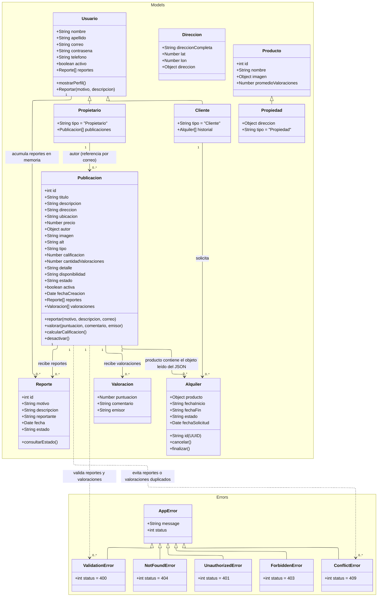

# `Diagrama de Clases`

Este diagrama reúne las entidades de dominio y la jerarquía de errores implementadas por la aplicación.
La composición de las capas y su flujo HTTP se documentan en [`Diagrama de Capas.md`](./Diagrama%20de%20Capas.md).

Para visualizar el preview del archivo en VSCode se puede usar una extensión Mermaid como: https://marketplace.visualstudio.com/items?itemName=MermaidChart.vscode-mermaid-chart.

