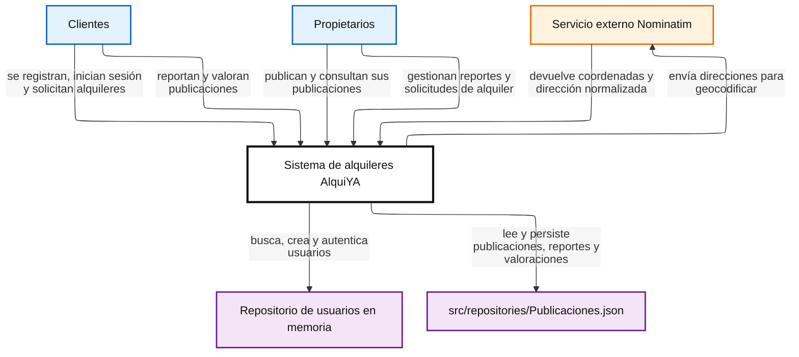

# `Diagrama de Contexto`

Este diagrama muestra los límites del sistema de alquileres y sus principales actores, sistemas externos y almacenes de datos.

Para visualizar el preview del archivo en VSCode se puede usar una extensión Mermaid como: https://marketplace.visualstudio.com/items?itemName=MermaidChart.vscode-mermaid-chart.

## Alcance

- Los clientes pueden consultar publicaciones, solicitar alquileres y crear valoraciones.
- Los propietarios pueden publicar propiedades, gestionar reportes y responder solicitudes de alquiler.
- El repositorio de usuarios mantiene los datos en memoria durante la ejecución.
- Las publicaciones se almacenan en `src/repositories/Publicaciones.json`.
- La ubicación se consulta mediante el servicio externo Nominatim.
- El sistema no implementa edición ni eliminación de publicaciones.
- No existe un sistema externo separado de manejo de usuarios, valoraciones o creación de publicaciones; esas capacidades forman parte de la aplicación.
